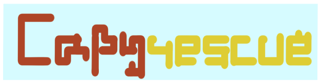

# CapyRescue

Logic puzzle game for phones, made in Godot 4.

Rules: one capybara in every row, every column and every colored region, and no two capybaras can touch, diagonals included. Boards are generated on the fly and each one has exactly one solution.



## Details

The generator picks a random valid placement, grows irregular regions around it, then runs a backtracking solver to make sure the board has a single solution. Boards with more than one are thrown away and regenerated. Tests check generated boards with a separate win checker rather than trusting the generator.

`core/` (board, move validation, solver, generator, win check) has no knowledge of scenes or UI; the screens just call into it.

The daily puzzle uses the date as its seed, so everyone gets the same board on the same day with no server involved. Streaks and best scores are stored locally.

Three lives per board. A wrong placement costs one. Score goes up with board size and down with time and mistakes.

44 tests with GUT, including UI tests that play full games through the real game screen. Test runs write to a separate save file so real progress is never touched.

## About `archive/`

The game was first prototyped in Unity, then rewritten in SwiftUI for iOS, then rebuilt in Godot so the same code can later target Android as well. The earlier versions are kept in `archive/`.

## Running

```
godot --headless --import     # first time only
godot --headless -s addons/gut/gut_cmdln.gd -gdir=res://tests -gexit
```

Or open `project.godot` in the editor.

Work in progress: the capybara art is mostly done, online leaderboards aren't there yet.
